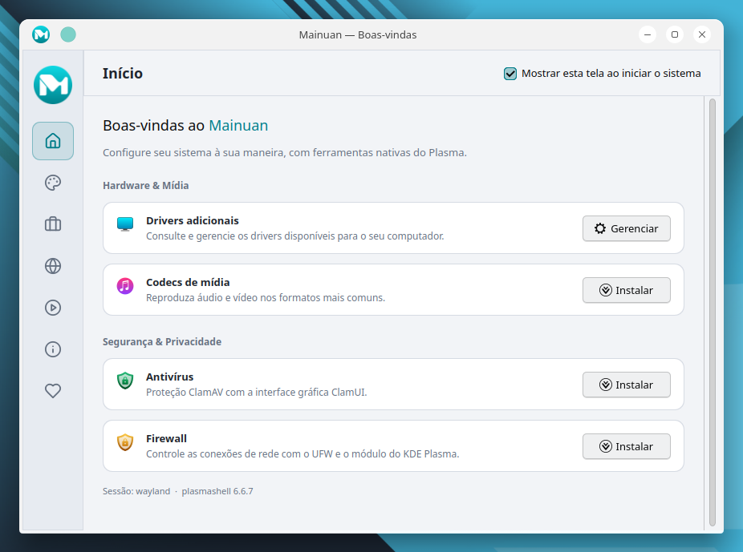

<div align="center">


# Mainuan Welcome

Welcome screen of **Mainuan Linux**: appearance, panel layout, essential applications and system information in one place.

[](https://github.com/mainuan/welcome/actions/workflows/build-deb.yml)
[](https://github.com/mainuan/welcome/releases/latest)
[](LICENSE)


[Português](README.md) · **English**

</div>

---

<p align="center"></p>


## About

Mainuan Welcome opens at first login and helps users set up the system: visual style, colours, Plasma panel layout, and installation of codecs, antivirus, firewall, office suites and browsers. Each user can turn off the automatic start.

It is a native C++17, Qt 6/QML and Kirigami application, with no Electron, Node.js, embedded Chromium or WebView. Administrative actions go through a helper that accepts only fixed profiles, authorised by Polkit; Welcome never asks for or stores passwords and has no telemetry. Mainuan themes, icons, wallpapers and plasmoids are not bundled: on a plain Kubuntu the app works, but does not reproduce the full Mainuan look.

## Features

- Dream, Tahoe and Breeze styles, light and dark, six accent colours, each with its own KDE colour scheme, Kora icons, wallpaper and avatar.
- Seven Plasma layouts (Classic 5 panels, 3 panels, Single panel, Tiling, Top panel, Lomiri, W7 panel) with widget checks, automatic backup and restore.
- Installation of office suites and browsers (FreeOffice, Vivaldi, Zen and others) through Flatpak or Debian packages, with progress and system authentication when needed.
- Antivirus, firewall and codec profiles; Google Docs and Office 365 shortcuts.
- Shortcut to [Mainuan Gestão de Drivers](https://github.com/mainuan/mainuan-gestao-drivers) when installed.
- On-demand machine report, local tutorials, Pix donation page with a locally generated QR code, and an open-at-login option.

## Installation

Welcome is preinstalled on the Mainuan ISO. To install it manually, download `mainuan-welcome_1.0.1_amd64.deb` and `SHA256SUMS` from the [latest release](https://github.com/mainuan/welcome/releases/latest), then:

```bash
sha256sum --check --ignore-missing SHA256SUMS
sudo apt install ./mainuan-welcome_1.0.1_amd64.deb
```

Coming from an experimental 2.x build? 1.0 is numerically lower, so add `--allow-downgrades`. See [docs/releasing.md](docs/releasing.md) (Portuguese).

## Usage

Open **Mainuan Welcome** from the application menu, or run `mainuan-welcome` (no options; a second instance raises the open window). Manual page: `man mainuan-welcome`.

## Technical information

| Item | Value |
|---|---|
| Language | C++17 and QML |
| Toolkit | Qt 6, Kirigami, KF6 (KConfig, KI18n), libqrencode |
| Base | Kubuntu 26.04 LTS, KDE Plasma 6.6, Wayland |
| Package | `mainuan-welcome` (Debian, `amd64`) |
| Architecture | amd64, baseline x86-64 (v1/SSE2), no AVX/AVX2 required; see [CPU gates](docs/cpu-compatibility.md) |

## Build and test

```bash
sudo apt-get build-dep --no-install-recommends ./
cmake -S . -B build -DCMAKE_BUILD_TYPE=Release -DMAINUAN_DEVELOPER_MODE=OFF
cmake --build build --parallel 2
QT_QPA_PLATFORM=offscreen ctest --test-dir build --output-on-failure
dpkg-buildpackage -us -uc -b
```

The full sequence run by CI is in [`.github/workflows/build-deb.yml`](.github/workflows/build-deb.yml) and in the Portuguese README.

## Translations

33 languages, English as the source language. See [docs/i18n/README.md](docs/i18n/README.md).

## Contributing

Use [Issues](https://github.com/mainuan/welcome/issues) and pull requests to `main`; every PR runs the full CI.

## Credits

Natanael Barbosa Santos ([@natanael-art](https://github.com/natanael-art)), Rafael Ruscher ([@ruscher](https://github.com/ruscher)) and Daigo ([@daigoasuka](https://github.com/daigoasuka)). Line icons from [Lucide](https://lucide.dev) (ISC).

## License

[GPL-3.0-or-later](LICENSE).
