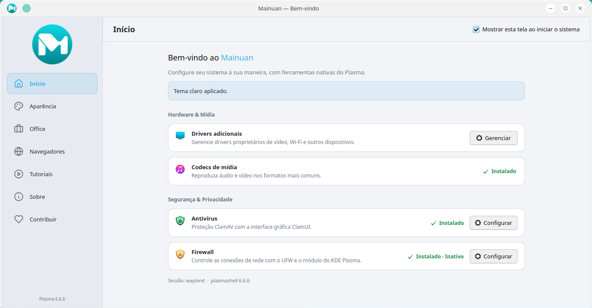
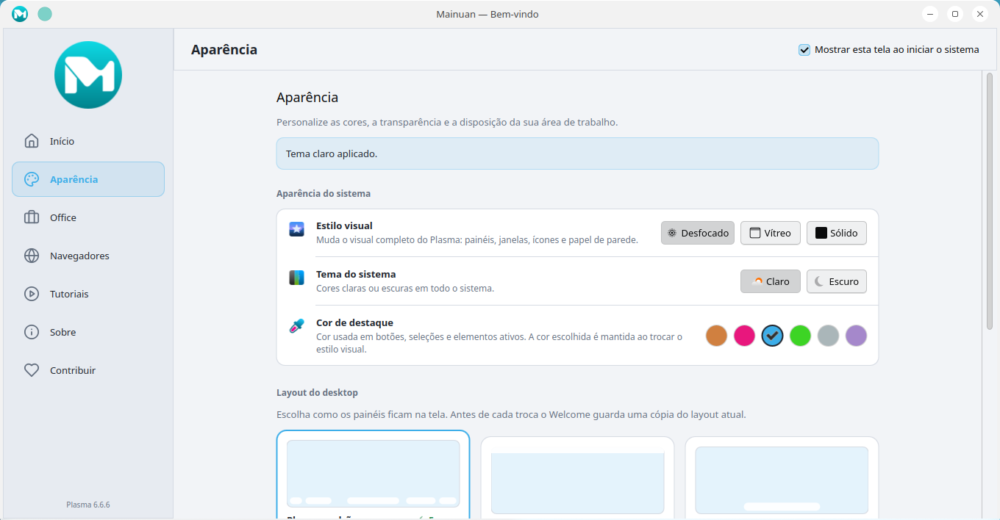

# Mainuan Welcome 1.0

Aplicação nativa de boas-vindas do Mainuan Linux, baseada em C++17, Qt 6/QML e
Kirigami. Destino suportado: **Mainuan / Kubuntu 26.04 LTS, KDE Plasma 6 e Wayland,
amd64**. Não utiliza Electron, Node.js, Chromium embarcado ou WebView.

O pacote de distribuição tem como alvo **x86-64 básico (v1/SSE2)**. O CI usa
uma base Ubuntu 26.04 sem variantes amd64v3, audita ELF/flags e testa o pacote
sob QEMU sem AVX/AVX2. A ISO e suas bibliotecas também precisam respeitar esse
alvo: consulte [o diagnóstico e os gates de CPU](docs/cpu-compatibility.md).

Repositório oficial: https://github.com/mainuan/welcome

## Funcionalidades

- Estilos Dream, Tahoe e Breeze, com variantes clara/escura e seis esquemas KDE.
- Sincronização de ícones Kora, wallpaper e avatar, preservando preferências e backups.
- Sete layouts: Clássico — 5 barras, 3 barras, Barra única, Tiling, Painel superior,
  Lomiri e Barra W7, com verificação de widgets, backup e restauração.
- Instalação de suítes Office e navegadores, incluindo FreeOffice, Vivaldi e Zen,
  com progresso, erros acessíveis e autenticação pelo sistema quando necessária.
- Perfis de antivírus, firewall e codecs; serviços online Google Docs e Office 365.
- Acesso à ferramenta independente Mainuan Gestão de Drivers, quando instalada.
- Relatório da máquina, tutoriais locais, contribuição Pix e opção de abrir no login.

| Início | Aparência |
|---|---|
|  |  |

As capturas documentam o desenvolvimento; pequenos detalhes visuais podem diferir.
Os temas, esquemas Dream, ícones Kora, wallpapers, avatares de origem e plasmoids
personalizados pertencem ao Mainuan e não são duplicados no pacote Welcome.
A ausência de recursos é tratada pelos serviços; instalar no Kubuntu sem esses
recursos não reproduz toda a personalização do Mainuan.

## Obter e instalar

Baixe `mainuan-welcome_1.0_amd64.deb` e
`SHA256SUMS` na [Release v1.0](https://github.com/mainuan/welcome/releases/tag/v1.0).
A Release publicada permanece intacta. Uma recompilação corrigida com a mesma
versão 1.0 deve ser identificada pelo commit e checksum do novo artefato; ela não
constitui atualização de versão pelo APT. Veja [como distribuir e reinstalar essa
compilação](docs/releasing.md#recompilações-corrigidas-da-versão-10).

Na pasta dos dois arquivos:

```bash
sha256sum --check SHA256SUMS
sudo apt install ./mainuan-welcome_1.0_amd64.deb
```

Para reinstalar a mesma versão, acrescente `--reinstall`. O pacote abre o Welcome
no login; cada usuário pode desativar “Mostrar esta tela ao iniciar o sistema”.

### Migração das versões experimentais superiores

**1.0 é a primeira versão oficial, mas é numericamente inferior às versões 2.x
experimentais.** O Debian confirma a comparação; o comando abaixo retorna zero:

```bash
dpkg --compare-versions 2.3.1.5 gt 1.0
```

Se já houver uma versão experimental instalada, confira o número e autorize o
downgrade explicitamente, após verificar o checksum:

```bash
dpkg-query -W -f='${Version}\n' mainuan-welcome
sudo apt install --allow-downgrades ./mainuan-welcome_1.0_amd64.deb
```

Não foi acrescentado epoch nem feita uma migração automática. Se um repositório
APT ainda oferecer uma versão 2.x, ele poderá voltar a ser preferido pelo APT.
O mantenedor deve coordenar esses canais; usuários que permanecerem em 2.x não
receberão automaticamente versões oficiais inferiores, como 1.0 ou 1.1.
Veja a [política de publicação e migração](docs/releasing.md).

## Compilações automáticas

O workflow [Build Debian package](https://github.com/mainuan/welcome/actions/workflows/build-deb.yml)
usa exclusivamente `ubuntu-26.04`:

- Push em `main`, PR para `main` ou execução manual: compila, testa e disponibiliza
  o pacote e `SHA256SUMS` como artefato por 30 dias, somente após validação.
- Push de uma tag versionada: faz as mesmas verificações e publica uma Release
  somente quando a tag corresponde exatamente à versão interna do pacote.
- PRs e execuções manuais nunca publicam Releases. Uma Release existente não é
  substituída; o workflow não cria versões nem tags.

Para uma compilação temporária, abra a execução aprovada, baixe o artefato em
**Artifacts**, extraia o arquivo e confira `SHA256SUMS`. Artefatos do Actions são
transitórios; Releases são publicações oficiais deliberadas pelo mantenedor.
**Disponibilizar um `.deb` no GitHub não cria um repositório de atualizações APT.**

## Compilar e testar localmente

Use o Mainuan/Kubuntu 26.04 e instale as dependências declaradas em `debian/control`:

```bash
git clone https://github.com/mainuan/welcome.git
cd welcome
sudo apt-get update
sudo apt-get install build-essential dpkg-dev fakeroot lintian
sudo apt-get build-dep --no-install-recommends ./
dpkg-checkbuilddeps
cmake -S . -B build -DCMAKE_BUILD_TYPE=Release -DMAINUAN_DEVELOPER_MODE=OFF
cmake --build build --parallel 2
ctest --test-dir build --output-on-failure --output-junit release-tests.xml
python3 .github/scripts/check_release.py tests build/release-tests.xml
python3 -m unittest discover -s .github/scripts -p 'test_*.py'
```

A lista de bibliotecas Qt6, KF6/KConfig, Kirigami e libqrencode e dos módulos QML
fica em `debian/control`; não há outra lista de bibliotecas no workflow. Os testes
QtTest, QML e de inicialização usam diretórios temporários, ferramentas simuladas
e renderização offscreen. Não instalam aplicativos nem alteram a sessão Plasma.
O verificador de release recusa testes ausentes, ignorados ou com falhas.
As suítes C++ recebem um barramento D-Bus privado por `dbus-run-session`
(dependência de compilação `dbus-daemon`), sem ativação de serviços instalados,
além de HOME e diretórios XDG temporários. Execute-as pelo CTest para manter esse
isolamento também durante `dh_auto_test`. O workflow verifica as seis suítes
sequencialmente e em paralelo; o empacotamento repete os testes obrigatórios.
Isso evita depender do socket da sessão do host: o debhelper cria outro
`XDG_RUNTIME_DIR`, sem esse socket. Sem barramento conectado, a consulta
assíncrona de wallpaper podia ficar sem sinal de conclusão antes mesmo de
executar o comando Plasma simulado. O barramento privado devolve o erro esperado
de serviço ausente; não inicia o Plasma, não exige serialização e mantém os
timeouts e as verificações de aparência existentes.

Para executar a aplicação compilada: `./build/bin/mainuan-welcome`.
Para gerar o pacote:

```bash
python3 .github/scripts/check_release.py metadata --tag v1.0
dpkg-buildpackage -us -uc -b
python3 .github/scripts/check_release.py package ../mainuan-welcome_1.0_amd64.deb --version 1.0
lintian --fail-on error ../mainuan-welcome_1.0_amd64.deb
mkdir -p dist
cp ../mainuan-welcome_1.0_amd64.deb dist/
(cd dist && sha256sum mainuan-welcome_1.0_amd64.deb > SHA256SUMS)
```

`dpkg-buildpackage` repete os testes e grava os pacotes na pasta acima do código.
Os diretórios gerados são ignorados pelo Git. Para limpar, use `debian/rules clean`
para o empacotamento e remova somente diretórios de build previamente conferidos;
eles podem conter arquivos que você tenha guardado manualmente.

## Manutenção, segurança e publicação

- [Arquitetura, segurança, backups e recursos do sistema](docs/architecture-and-maintenance.md).
- [Checklist de publicação, comandos Git e downgrade](docs/releasing.md).
- [Inventário e limpeza da preparação 1.0](docs/cleanup-1.0.md).
- [Índice da documentação e histórico experimental](docs/README.md).

A configuração Pix fica em `/etc/mainuan/welcome.conf`, com fallback por usuário;
não há telemetria. O helper aceita apenas perfis fechados e usa Polkit, sem senha
administrativa no Welcome. Os testes reais de integração gráfica, autenticação e
recursos específicos da distribuição continuam sendo responsabilidade do Mainuan.

Licença: GPL-3.0-or-later, conforme [LICENSE](LICENSE) e
[debian/copyright](debian/copyright). Créditos originais preservados: Mainuan
contributors; ícones Lucide sob ISC em [qml/icons/LICENSE.lucide](qml/icons/LICENSE.lucide).
O campo Debian Maintainer permanece `ruscher <rruscher@gmail.com>`; esta preparação
não presume uma transferência de manutenção.
